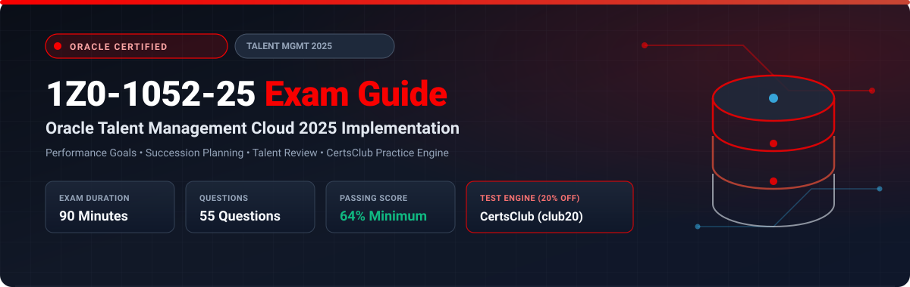

  

# Oracle Talent Management Cloud 2025 Implementation Professional (1Z0-1052-25) Exam Study Guide & Practice Test Resource Portal

[-f80000?style=for-the-badge&logo=oracle&logoColor=white)](https://education.oracle.com/)
[-f80000?style=for-the-badge&logo=oracle)](https://education.oracle.com/)

[-28a745?style=for-the-badge&logo=shield)](https://www.certsclub.com/oracle/)

---

## 1. Exam Overview & Candidate Profile

The **Oracle Talent Management Cloud 2025 Implementation Professional (1Z0-1052-25)** exam certifies expertise in configuring and managing Oracle Fusion Cloud Talent Management. Key competencies tested include Profile Management (Person and Model profiles, competencies), Goal Management (performance and development goals), Performance Management (performance document templates, feedback, evaluations), Succession Management (talent pools, 9-box grids), and Talent Review meetings.

Passing 1Z0-1052-25 awards the **Oracle Talent Management Cloud 2025 Certified Implementation Professional** credential.

### Target Candidate Profile & Career Roles
* **Talent Management Functional Consultants**
* **HR Performance & Succession Architects**
* **Workforce Capability & Development Specialists**

---

## 2. Key Exam Specifications

| Parameter | Official Specification |
| :--- | :--- |
| **Exam Code** | 1Z0-1052-25 |
| **Exam Title** | Oracle Talent Management Cloud 2025 Implementation Professional |
| **Associated Credential** | Oracle Talent Management Cloud 2025 Certified Implementation Professional |
| **Duration** | 90 Minutes |
| **Number of Questions** | 55 Questions |
| **Passing Score** | 64% |
| **Question Format** | Multiple Choice (Single and Multiple Select) |
| **Delivery Vendor** | Pearson VUE / Oracle University Online Remote Proctoring |
| **Recommended Practice Test Engine** | **[1Z0-1052-25 Practice Test - CertsClub](https://www.certsclub.com/oracle/)** (Coupon: `club20` for 20% off) |

---

## 3. Official Blueprint & Exam Domain Breakdown

| Domain Code | Domain Title | Weighting | Key Competencies Covered |
| :--- | :--- | :---: | :--- |
| **1.0** | **Profile Management** | **20%** | Person Profiles, Model Profiles (Job/Position), Content Types, Rating Models, Competencies. |
| **2.0** | **Goal Management** | **20%** | Performance and Development Goal Plans, Goal library, Mass assignment, Goal approval rules. |
| **3.0** | **Performance Management** | **30%** | Performance Templates, Review Periods, Sections (Goal, Competency, Overall), Calibration, Participant Feedback. |
| **4.0** | **Succession Management & Talent Pools** | **15%** | Succession Plans (Incumbent vs Job/Position), Talent Pools, Readiness levels, Risk of Loss, Impact of Loss. |
| **5.0** | **Talent Review Meetings** | **15%** | Talent Review Templates, 9-Box Matrix configuration, Conducting meetings, Action items. |

---

## 4. Scenario-Based Demo Question & Explanation

### Question 1: Performance Template Section Calculation
**Scenario:** A company configures a Performance Document Template where the Overall Summary rating must be calculated automatically as a weighted average: 60% based on Performance Goals and 40% based on Competencies.

Where is this weighting configured in Performance Management?

A) In the Review Period setup  
B) In the **Process Flow** tab of the Performance Template  
C) In the **Structure** tab of the Performance Template on the Overall Summary section  
D) In a Fast Formula only  

**Correct Answer:** **C**

**Detailed Explanation:**
* In Oracle Performance Management, the **Structure** tab of the Performance Template allows administrators to configure calculation rules for the Overall Summary section, specifying the percentage weighting allocated to the Goals section and Competencies section.

---

## 5. Recommended Preparation Strategy & Practice Testing Engine

1. **Build a Full Performance Cycle:** Create rating models, performance goal plans, and performance templates in an HCM test pod.
2. **Practice with Full-Length Mock Exams:** Use **[CertsClub Oracle 1Z0-1052-25 Practice Tests](https://www.certsclub.com/oracle/)**.
   * Comprehensive questions covering 9-box grids, template process flows, and talent reviews.
   * Enter discount coupon code **`club20`** at checkout on [CertsClub](https://www.certsclub.com/oracle/) for an immediate 20% discount.

---

## 6. Official Documentation & References

* [Oracle Fusion Cloud Talent Management Documentation](https://docs.oracle.com/en/cloud/saas/human-resources/talent-management/)
* [Oracle University 1Z0-1052-25 Exam Details](https://education.oracle.com/)
* [CertsClub 1Z0-1052-25 Practice Engine](https://www.certsclub.com/oracle/)
